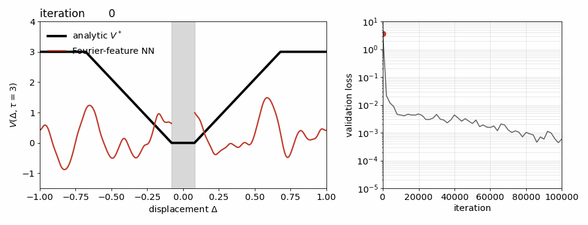

# Fold formation in the Fourier-feature network (Fig. "fold evolution")

A separate run of the Fourier-feature configuration on $S^1$, seed 0, with the campaign flags but
a shorter budget of $10^5$ iterations, saving the network along training: at the initialisation,
at log-spaced early iterations and then every 500 iterations (217 snapshots in total).

* `gpu_critic_snap.py` — the campaign trainer plus the two options `--snap_every N` and
  `--snap_dir DIR`.  The run was produced with the command in `circle_smooth_s0_1e5/cmd.txt`:

  ```
  python gpu_critic_snap.py --geom circle --width 128 --bc_margin 1.0 --restarts 1 --tau_min 0.0 \
         --iters 100000 --seed 0 --snap_every 500
  ```
* `make_evolution.py [run_dir]` — evaluates every snapshot at $\tau = 3$ on 1201 points of
  $S^1$ and writes, into the run directory, `evolution_profiles.npz` (all profiles, read by the
  notebook section "Fold evolution" to draw the paper figure), `fold_evolution.gif` (all snapshots
  against $V^*$, with the validation-loss curve) and a static `fig_fold_evolution.pdf`.
* `circle_smooth_s0_1e5/` — `cmd.txt`, `train.log`, the loss history `gpu_circle.json`,
  `evolution_profiles.npz`, the gif and the static figure.  The snapshots themselves
  (`snapshots/`, 16 MB) and the final checkpoint are not versioned.

The folds are fixed within the first ~1000 iterations, at $|\Delta| \approx 0.24, 0.30, 0.50,
0.67, 0.81$; afterwards the loss falls from $10^{-2}$ to $6\times10^{-4}$ while the folds only
sharpen.


